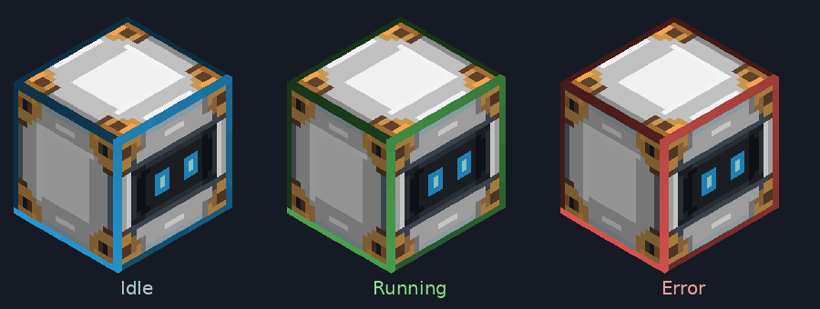
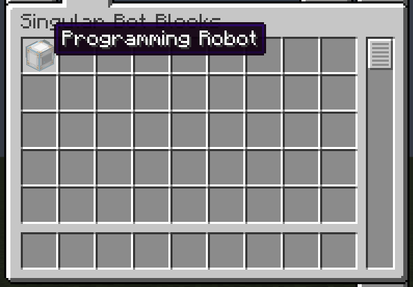
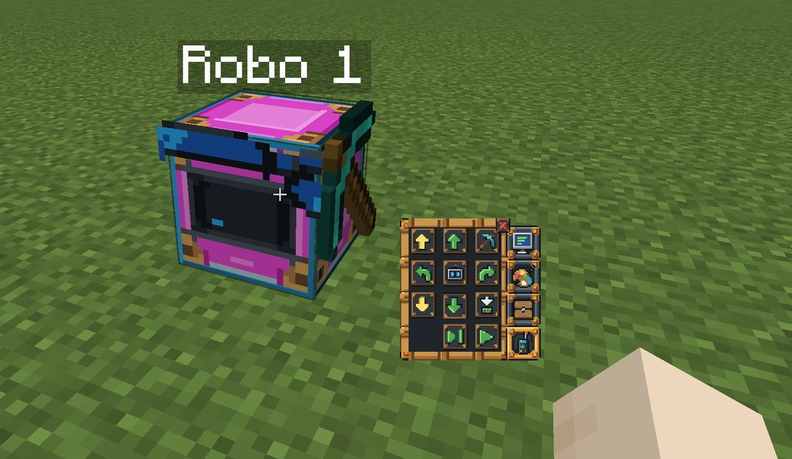
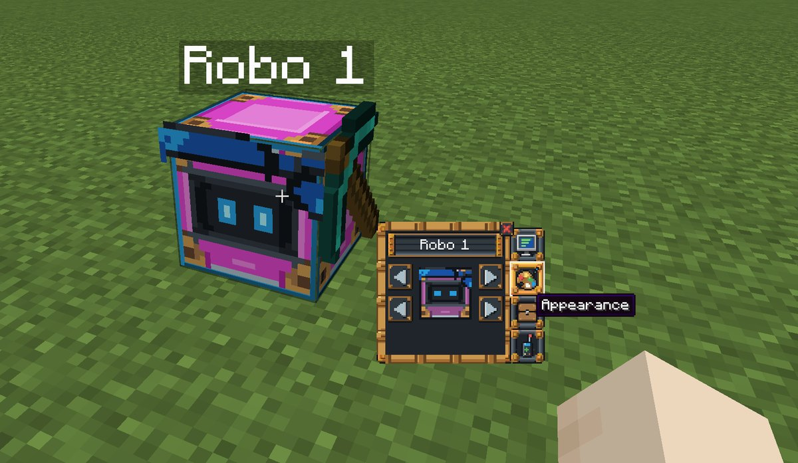
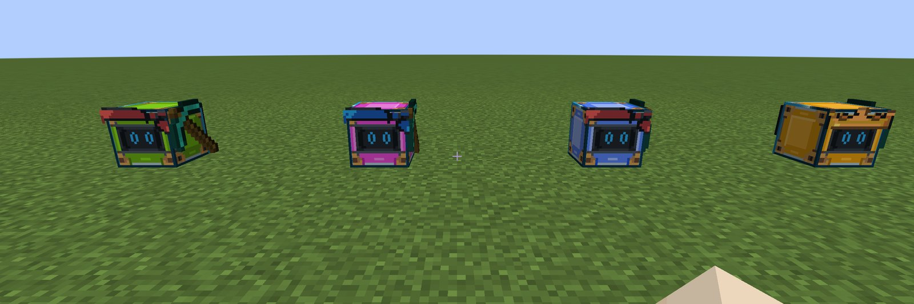
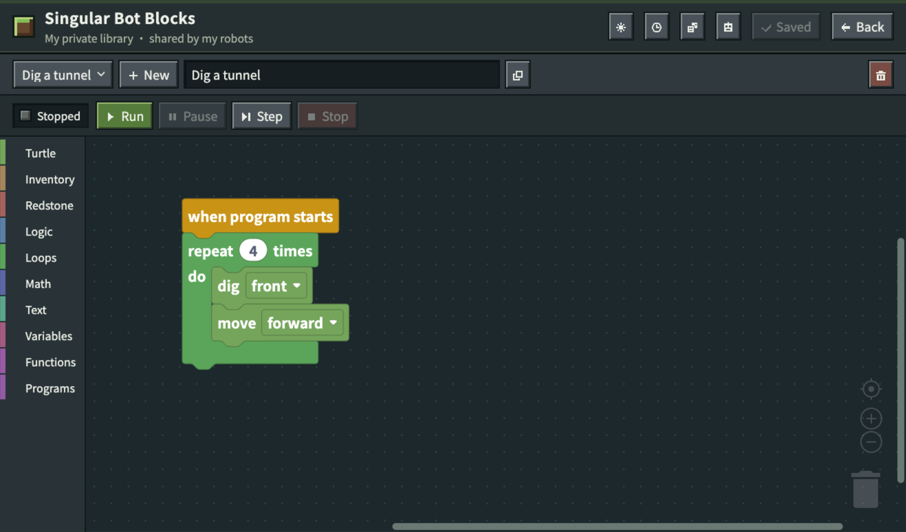
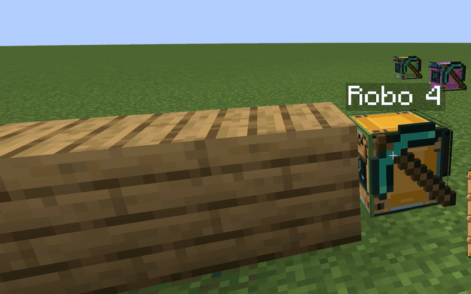
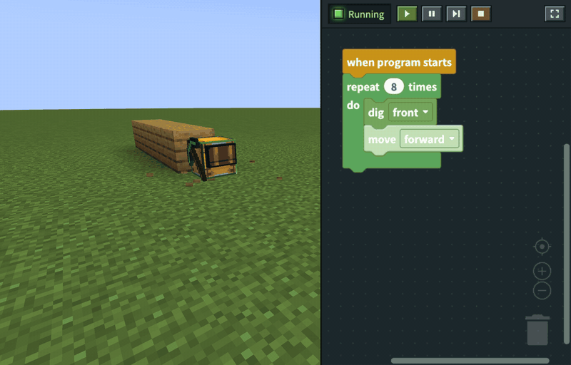

# Singular Bot Blocks

A classroom mod for Minecraft Java 1.21.1 / NeoForge: students program their own robots with Blockly blocks inside the game, running on CC: Tweaked. No remote item, no fuel and no separate app: right-click your robot and start coding.

> **Disclaimer.** Singular Bot Blocks is an independent, unofficial project inspired by ComputerCraftEdu. It is not affiliated with, endorsed by or connected to TeacherGaming LLC, Daniel Ratcliffe, the CC: Tweaked project or Mojang. NOT AN OFFICIAL MINECRAFT PRODUCT. NOT APPROVED BY OR ASSOCIATED WITH MOJANG OR MICROSOFT.

**Status: gameplay development build with programming robots, remote control, appearance, server Blockly/Lua execution, debugger, libraries, teacher controls and guarded restoration. This is not a classroom-ready release.** Full legacy, native input and multiplayer acceptance remain pending.

## The robot

A light runs around all twelve edges of every robot, in every body colour, and its colour shows what the robot's program is doing:

| Light | Meaning |
| --- | --- |
| Silver-blue | Idle: no program is running. |
| Green | A program is running (or paused). |
| Red | The program stopped with an error. Clearing the error in the robot's controller turns the light blue again. |

The robot also glows on its own. Its eye screen and edge light stay bright in the dark, and a placed robot lights up the blocks around it as brightly as glowstone (light level 15), so students can find and follow it at night or in a cave. White robots also give off small sparks in the light's colour.

## What students can do

- **Get a robot.** In Creative, the Singular Bot Blocks tab (after ComputerCraft) holds one programming robot with a built-in diamond pickaxe. In Survival, combine a CC turtle with green dye. No remote item and no fuel are needed.
- **Drive it by hand.** Right-click your robot to open its small controller: move up/down/forward/back, turn, dig and place, open its 16-slot inventory, and switch to the robot's point of view.
- **Make it yours.** Give it a name, one of 16 body colours and one of 17 decorations (or none). Your choices become the default for the next robot you place.
- **Program it with blocks.** The Program tab opens a full-screen, Minecraft-themed Blockly editor: robot actions and checks, inventory, item and block IDs with a searchable picker, redstone, logic, loops, variables, maths, text and functions. Run, pause, step and stop. Run sends you back to the controller so you can watch the robot work. Open the Program tab again while it runs, or step through it, and the editor shrinks to the side so you can see the highlighted block and the robot at the same time. Errors point to the block (or Lua line) that failed.
- **Keep your work.** Each student has one private program library and activity history shared by all of their robots. Programs auto-save, survive world reloads and stay with the student even if a robot is broken. Other students can break your robot (its inventory drops normally) but cannot read your code or control it.
- **Grow into Lua.** Advanced classes can turn on Lua: preview the Lua generated from blocks, convert a program into an editable Lua copy, or write Lua directly with `turtle`, `redstone` and `edu` APIs.
- **In their own language.** The controller, messages, errors and the whole editor follow the Minecraft language setting and cover all 143 languages of Minecraft 1.21.1, with Traditional Chinese written for the classroom.

### In the game

| | |
| --- | --- |
|  |  |
| One robot in the creative tab | Right-click the robot to drive it |
|  |  |
| Name it, pick a colour and a decoration | Every student's robot can look different |

## For teachers

Teachers are operators (OP level 2); everyone else is a student. `/botblocks` switches the class between beginner (blocks only, the default) and advanced (Lua on), stops every robot at once, and turns on Teacher send to deliver a program straight into students' libraries. Teachers can lock a student's robot, and Teacher takeover lets them edit a student's program live while the student watches. Coloured permission blocks mark where robots may build, and a recorded snapshot can undo an exercise after checking that nothing else changed. `/gamerule doTileDrops false` stops ordinary manual-mining drops while robots still collect what they dig. Details are in the [gameplay guide (繁體中文 / English)](docs/gameplay-guide.md).

## Installing

Every client and the server need Minecraft 1.21.1, NeoForge 21.1.252 or a later 21.1.x, CC: Tweaked 1.120.2 and the same Singular Bot Blocks JAR. Each client also needs MCEF 2.1.6-1.21.1 with the matching native browser package, which runs the editor; the server needs no MCEF. MCEF's normal binary downloader is currently unavailable, so prepare the native package before starting clients, as described in [docs/install.md](docs/install.md). Use a new world: programs from the 1.8.9 mod are not converted.

The mod keeps no chunks loaded: a robot only works while a player is near enough to keep its chunk loaded, so its program stops when its owner leaves and nobody else is nearby.

## Fixed versions

| Component | Version |
| --- | --- |
| Minecraft | 1.21.1 |
| Java target | 21 |
| NeoForge | 21.1.252 (build); accepts any later 21.1.x |
| CC: Tweaked | 1.120.2 |
| MCEF (client only) | 2.1.6-1.21.1 |
| Blockly | 11.2.2 |
| JCEF | a78e832f9f13c2c688caea3d04d8b84fcd238d94 |
| CEF | 116.0.27+gd8c85ac+chromium-116.0.5845.190 |

New worlds and a new program format are used; no Minecraft 1.8.9 conversion is included.

## Development

Use a JDK 21, Node.js 22 and Python 3.11 or newer. Development and native deployment instructions are in [docs/install.md](docs/install.md); gameplay instructions are in [繁體中文 / English](docs/gameplay-guide.md). Do not install this development build in a classroom world.

Blockly assets are bundled locally. No CDN is needed during lessons. MCEF's normal binary downloader is currently unavailable, so the native workflow builds the pinned official JCEF source against official CEF distributions. Native packages are prepared before clients are started. A dedicated server requires no MCEF/native browser package.

## License

This project's own code and artwork are released under the [MIT License](LICENSE). Bundled third-party components keep their own licenses (Blockly: Apache-2.0, Noto Sans TC: SIL OFL 1.1, and the Jersey 10 font used for the cover art word mark: SIL OFL 1.1); see [THIRD_PARTY.md](THIRD_PARTY.md).

## Contributing

Issues and pull requests are welcome. Run `./gradlew build`, `npm test --prefix editor` and `python -m unittest discover -s scripts -p 'test_*.py'` before opening a pull request.

## Provenance

Inspired by the original ComputerCraftEdu by Daniel Ratcliffe and TeacherGaming LLC, used only as a reference for behaviour and classroom workflow. No code or artwork from it is included. See [THIRD_PARTY.md](THIRD_PARTY.md).

